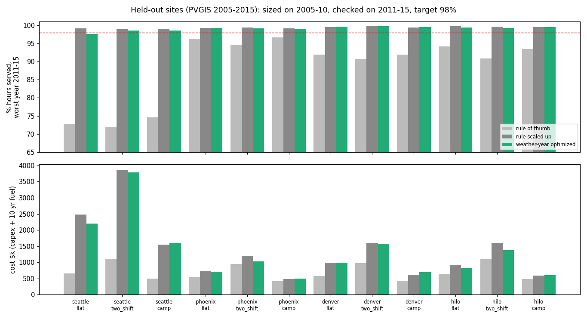

# Weather-year microgrid sizing that holds its uptime target

> Unofficial prototype by Kushagra Pratap Singh. Not affiliated with Micora.
> Weather is real: hourly PV output from **PVGIS** (© European Union, JRC; PVGIS-NSRDB, 2005–2015). Loads, prices and battery/generator parameters are illustrative.

## The problem
Micora ships solar blocks plus a battery container, with small generators or fuel cells as backup. It sizes the system "for each application's needs", and compares "Micora Hybrid 98%" uptime with diesel's ~95% ([micora.com](https://www.micora.com)). Whether a given system delivers 98% depends on **this site, this load and a bad year**, not an average one. Multi-day cloudy stretches drain a battery that an average-day calculation says is plenty.

## What I built
`sizer/` (numpy):
- **Data:** `fetch_pvgis.py` downloads hourly PV output per kWp for 8 US sites, 2005–2015, from the public PVGIS API. Tilt is the site latitude (max 35°), losses 14%. **Data QA:** PVGIS-NSRDB has 12 consecutive all-zero days in Sept 2012 at *every* site. That's a data gap, not weather; it's detected and dropped. Before I found it, it made every design fail 2012.
- **Loads in local time:**
  - 24/7 flat (data center or process);
  - two-shift manufacturing (weekdays 06–22);
  - remote camp with an evening peak.
- **`core.simulate`:** hourly dispatch, vectorised over hundreds of configurations at once:
  - 400 W Solar Blocks;
  - 5 kWh LFP racks with 90% usable, 0.5C, and 92% round trip;
  - an optional generator with a 30% minimum load, a HOMER-style fuel curve, and **one 2,000 L tank per year** (no fuel deliveries).
  Output: share of hours fully served, unmet kWh and fuel, per year.
- **`optimize.size`:** the cheapest grid point (blocks × racks × generator) that keeps **≥ 99% of hours served in every sizing year** (2005–2010). The 98% target plus a 1-point margin was chosen on the dev sites before held-out.
- **Baselines:**
  - **rule of thumb:** daily kWh ÷ (average peak-sun-hours × 0.8), one day of battery, generator at half peak;
  - **rule scaled up:** the same system multiplied up until it passes the sizing years, which is how an installer would fix it.

## Results: held-out, first run
Four sites never run during development: Seattle, Phoenix, Denver and Hilo. Three loads each, sized on 2005–2010 and checked against **98% in the worst of 2011–2015**. Sites and margin were frozen in git before the run (`heldout/config.json`, commit cc35ef8). Nothing was changed after. Raw output: `out/heldout_first_run.json`.

| Method | Meets 98% in the worst test year | Total cost, 12 systems (capex + 10 yrs fuel) |
|---|---|---|
| rule of thumb | **0 / 12** (worst years 72–97%) | $8.41M |
| rule scaled up until it passes 2005–10 | 12 / 12 | $16.62M |
| **weather-year optimized (this)** | **11 / 12** | **$15.89M** (4% less) |



**What this says, honestly**
- **The rule of thumb never meets 98% in a bad year.** Seattle drops to 72–75%, sunny Phoenix to 95–97%. A quote built on averages over-promises everywhere.
- **Fixing it costs about 2× the rule-of-thumb price** at these loads. Uptime is expensive, and a quote should show that trade-off per site.
- **The optimizer is only 4% cheaper than simply scaling up, and it missed once** (Seattle flat load: 97.6% in its worst test year). Five test years can be worse than the six sizing years. It's also not cheaper in every case: in the Austin demo, the scaled rule is cheaper because the optimizer's grid only allows a generator of 0 or 0.3 × peak, while the rule uses 0.5 × peak. A finer grid, or sizing on all 11 years with a bigger margin, would fix both.
- **The real value is the per-site, per-year uptime number,** not the optimizer. The simulator shows how a configuration does in each year at each site.
- **Not modelled:** PV and battery degradation, soiling beyond the 14% loss, temperature derating of batteries, inverter limits, real prices.

## Run it
```
python demo.py                  # Austin, evening-peak camp: three designs checked year by year on 2011-2015
python evaluate.py heldout      # the table above (~8 min)
python -m unittest discover tests
```
Python 3.10+, numpy (matplotlib only for `docs/plot.py`). Data is included in `data/pv/`; `python fetch_pvgis.py` re-downloads it.

Demo output (abridged):
```
rule of thumb                 2011: 93.1%  2012: 95.1%  2013: 92.2%  2014: 91.2%  2015: 87.6%   -> MISSES 98%, $449k
rule x1.7 (scaled)            2011: 99.3%  2012: 99.8%  2013: 99.5%  2014: 99.7%  2015: 98.5%   -> MEETS 98%, $718k
weather-year optimized        2011: 99.2%  2012: 99.8%  2013: 99.7%  2014: 99.9%  2015: 99.2%   -> MEETS 98%, $792k
```
